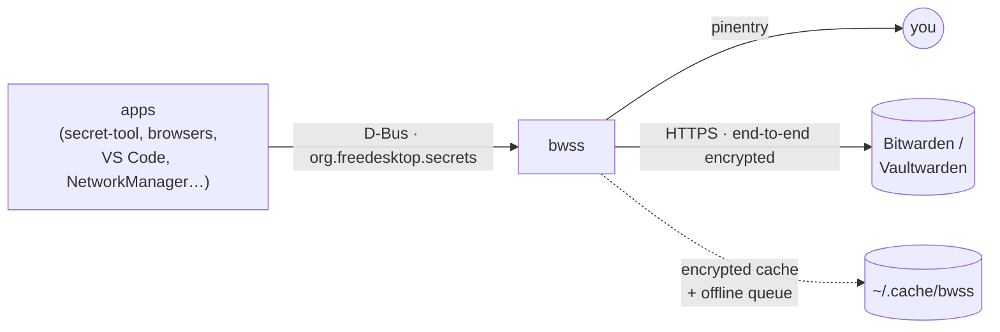

<div align="center">

# 🔐 bwss

**Your Linux keyring, in your Bitwarden vault.**

A drop-in replacement for gnome-keyring's Secret Service that keeps every
secret in Bitwarden, so it follows you to every machine the way iCloud
Keychain does on a Mac.

`org.freedesktop.secrets` · Rust · Bitwarden & Vaultwarden · offline-first · per-app access control

</div>

---

Your browser, IDE, mail client, Wi-Fi manager and `git` keep their passwords
in the desktop keyring. On Linux that keyring is a file on one machine: set up
a new laptop and you start over; lose the disk and the secrets go with it.

**bwss** implements the standard
[freedesktop Secret Service API](https://specifications.freedesktop.org/secret-service/),
so every app that already talks to gnome-keyring or KWallet works unchanged.
The storage behind it is your Bitwarden vault: any login or secure note you
mark with a `bwss:id` field becomes a keyring item.

```console
$ secret-tool store --label="GitHub token" service github user me
Password: ••••••••          # first use: a pinentry dialog asks for your Bitwarden master password
$ secret-tool lookup service github
ghp_8x7…
```

…and *GitHub token* now shows up in Bitwarden on your phone, and in the
keyring of every other machine running bwss.

## ✨ Features

- **Works with your existing apps.** Anything that speaks Secret Service:
  libsecret (`secret-tool`, GNOME apps), Chromium and Electron apps such as
  VS Code, NetworkManager, Python `keyring`/`secretstorage`, and `oo7`.
- **Synced everywhere.** Items are ordinary Bitwarden logins and secure
  notes, visible and editable in every Bitwarden client and shared by every
  bwss instance on the same account.
- **Unlock once.** The first app that needs a secret brings up a pinentry
  dialog; so does `bwss unlock`.
- **Locks itself.** On `bwss lock`, after an idle timeout, when the machine
  goes to sleep, and when your session's screen locks.
- **Per-app access control, like the macOS Keychain.** The app that created
  an item uses it freely; any other app is asked *Allow / Deny*, then
  *Always allow / Only this time*.
- **Offline-first.** The last sync is cached, still encrypted. The keyring
  unlocks and reads with no network; writes are queued in order and replayed
  when you are back online.
- **Locked, but findable.** A locked keyring still answers searches, so apps
  trigger the unlock prompt instead of failing silently after a reboot.
- **Your Bitwarden data stays intact.** Editing an item keeps its username,
  URIs, custom fields, attachments and history; a replaced login password
  goes into password history.
- **Small and self-contained.** One binary (the musl build is fully static)
  that talks to Bitwarden directly, with no `bw` CLI or Node.js.

## 🧭 How it compares

| | gnome-keyring | KeePassXC (Secret Service) | **bwss** |
|---|---|---|---|
| Where secrets live | local keyring file | local KDBX file | **your Bitwarden vault** |
| Multi-device sync | — | sync the file yourself | **built in (Bitwarden)** |
| Phone / browser access | — | via third-party apps | **every Bitwarden client** |
| Works offline | ✓ | ✓ | ✓ (cached, queued writes) |
| Ask before another app reads a secret | — | ✓ | ✓ |
| Self-hostable server | — | — | ✓ (Vaultwarden) |

## 🚀 Quick start

**1. Build and install.**

```sh
git clone <this repository> && cd bwss
cargo install --path .            # puts bwss in ~/.cargo/bin (Rust 1.89 or newer)
```

**2. Connect your account.** bwss shares one config file with the other dybw
tools, `~/.config/dybw/config.toml`: your account is a profile there, and
bwss's own settings go in `[bwss]`. Start from the example, then store a
personal API key from the Bitwarden web vault (*Settings → Security → Keys →
View API key*):

```sh
install -Dm644 contrib/config.example.toml ~/.config/dybw/config.toml   # then edit it
bwss login --client-id user.xxxxxxxx      # asks for the client_secret
```

**3. Take over the keyring.** Stop gnome-keyring's secrets component (or
KWallet's or KeePassXC's integration) first, then:

```sh
install -Dm644 contrib/bwss.service ~/.config/systemd/user/bwss.service
install -Dm644 contrib/org.freedesktop.secrets.service \
  ~/.local/share/dbus-1/services/org.freedesktop.secrets.service
systemctl --user daemon-reload
systemctl --user enable --now bwss.service
```

**4. Use it.** Your apps already know how. Check with `bwss status`.

**Coming from the old folder-based bwss?** bwss stops on a
`~/.config/bwss/config.toml` and asks you to run `bwss config migrate`. That
moves the account, settings, API key and device id into the shared file and
state directory, and renames the old files to `*.migrated`; it refuses an old
config with a key this version no longer has (remove that key, such as
`whole_vault`, first). Vault items are not migrated: items the old version
created carry `bwss:id` and show up as marked items, but its folder-based
collections are not recognised. The cache and locked index are rebuilt, and
an old offline queue is renamed `queue.json.legacy` and never replayed, so
flush offline writes before upgrading. See
[`docs/design.md`](docs/design.md) §14.

## 🗂️ How your vault becomes a keyring



**An item joins the keyring when it carries a custom field named `bwss:id`.**
The value can be any non-empty text. Add the field to a personal login or
secure note, in any folder, with any Bitwarden client. Unmarked items stay
private: bwss reads only their field names, never decrypts them further, and
never puts them on the bus.

| Secret Service | Bitwarden |
|---|---|
| default collection (`login`, alias `default`) | marked items without `bwss:collection` |
| collection "Work" | items with `bwss:collection=work` |
| item label | the `bwss:label` field, falling back to the item name |
| secret | see *Reading the secret* below |
| attributes (`service=github`, …) | custom fields `bwss:attr:service`, … |
| `session` collection | memory only, never stored |

- **Finding an item you marked by hand.** Apps also see the derived
  attributes `bwss:id`, `bwss:name`, `bwss:username` and `bwss:uri`, so
  `secret-tool lookup bwss:name GitHub` works even though no app created the
  item.
- **Reading the secret.** The first of these that exists wins:
  1. a custom field `bwss:password` (even when empty);
  2. the item's notes, when the field `bwss:location=notes` is set;
  3. the login password (logins) or the note text (secure notes).
- **Writing the secret** goes back where it was read. Changing a login
  password keeps the old one in password history, as the official clients do.
  Add a `bwss:password` field when you want an app-only value and leave the
  login password alone. Binary secrets never go into your login password or
  note text: bwss adds a hidden `bwss:password` with `bwss:encoding=base64`
  instead.
- **New items** that apps create are personal secure notes in the `folder`
  from your config (default `secret-service`), with the secret in
  `bwss:password`. A very large secret uses the new note's own notes.
- **Deleting from an app** removes every `bwss:*` field. The item goes to the
  Bitwarden trash only when nothing of yours is left; a login password, your
  own notes or another tool's fields (such as `obsidian:*`) keep it, just no
  longer marked.
- **Collections** come from the `bwss:collection` field, not from folders.
  `login` (alias `default`) always exists; the collections apps created are
  listed in a secure note marked `bwss:id=_collections`.

bwss follows the **dybw data model 1.4**, shared with the Obsidian plugin
keychain-bitwarden. Under the hood it implements Bitwarden's client-side
crypto itself (PBKDF2 or Argon2id, HKDF, AES-256-CBC with HMAC): only
ciphertext crosses the network, the master password never leaves the machine,
and the API key only *authenticates*; decrypting still needs the master
password.

## 💻 Commands

| Command | What it does |
|---|---|
| `bwss daemon [--replace]` | Run the Secret Service (the systemd unit does this). `--replace` takes over from another running provider. |
| `bwss status` | Locked or unlocked, item count, queued offline changes. |
| `bwss unlock` | Unlock through the daemon's own pinentry; no password crosses the bus. |
| `bwss unlock --password-stdin` | For scripts and login hooks: send the password read from stdin (see Security below). |
| `bwss lock` | Lock the keyring and forget the keys. |
| `bwss sync` | Pull changes from Bitwarden now (otherwise every `sync_interval_seconds`). |
| `bwss login --client-id <id> [--client-secret-stdin]` | Save the API key of the profile bwss serves, bound to its server. |
| `bwss acl off` / `on` | Turn per-app access control off or on, on this device only (asks on the terminal before turning it off). |
| `bwss index derived on` / `off` | Put item names, usernames, URIs and ids in the locked index on this device, or take them out (the default). |
| `bwss config migrate` | Move an old `~/.config/bwss/config.toml` into the shared dybw file. |

## ⚙️ Configuration

Everything lives in `~/.config/dybw/config.toml`;
[`contrib/config.example.toml`](contrib/config.example.toml) documents every
key. In short:

- **Top level and profiles**: `default` (the profile to serve),
  `[profiles.<name>]` with `server_url` and `email`, and the shared
  `lock_timeout_minutes` (default 60; 0 turns the idle lock off),
  `sync_interval_seconds` (default 300) and `pinentry`. A profile may
  override the shared keys.
- **`[bwss]`**: `profile`, `folder` for new items (default `secret-service`),
  and `backend` (`bitwarden`, or `memory` for tests and demos).
- An unknown key in the top level, the served profile or `[bwss]` stops bwss,
  so typos fail loudly. Other tools' sections are ignored.

State lives outside the config: the API key in
`~/.local/state/dybw/profiles/<profile>/credentials` (mode `0600`), device
decisions under `~/.local/state/dybw/tools/bwss/`, and the encrypted cache,
offline queue and locked index under `~/.cache/bwss/`.

## 🔒 Security

The full model is in [`docs/design.md`](docs/design.md) §11; these are the
parts you should know.

**Keys and locking**

- The master password is used only locally, to derive keys. Key material is
  zeroized when the keyring locks.
- The keyring locks on `bwss lock`, after `lock_timeout_minutes` without use,
  when the machine goes to sleep, and when the session locks (systemd-logind
  on the system bus; without it bwss logs a warning and carries on). Run from
  a login session, it follows that session's lock. Run as a systemd user
  unit, which belongs to no session, it follows the screen lock of any
  session of your own user, and no other user's. Lock signals are accepted
  only from logind itself.
- On Linux the daemon disables core dumps and ptrace-style attach. It does
  not `mlock` memory.

**Unlocking**

- `bwss unlock` is the safe way: the daemon asks through its own pinentry, so
  no password crosses the bus.
- `bwss unlock --password-stdin` sends the password over the session bus to
  the process that owns bwss's control name, but only after checking that it
  is a `bwss daemon` of your user running the same installed file as the CLI,
  by its command line and start time. Because the daemon is not dumpable, its
  `/proc/<pid>/exe` cannot be read, so this check is best effort: it stops a
  look-alike service, not another process of yours that starts a real
  `bwss daemon` to pass it. Use it only if you accept that.
- Only the `bwss` CLI itself may send the master password to the daemon
  (`Control1.UnlockWithPassword`); any other executable is refused.

**Per-app access control**

- The check fails closed: only an explicit *Allow* grants access.
- A script run from a file (`python3 ~/bin/backup.py`) is an app of its own,
  identified by interpreter and script path. Interpreters running code from
  `-c`, `-m` or stdin, and apps bwss cannot identify, are asked every time and
  are never offered *Always allow*. Programs that are themselves not dumpable
  (gpg-agent, sandboxed browsers) cannot be identified, so they are asked
  every time too.
- Grants (`bwss:acl`) sync with the item, but a device honours one only after
  it granted or confirmed it there. Those decisions live in
  `~/.local/state/dybw/tools/bwss/acl-confirmed`, sealed with your vault key
  and never synced; deleting the file makes bwss ask again.

**On disk and on the network**

- On disk there is only Bitwarden ciphertext, plus the locked index. Offline
  writes are sealed under a key of their own, derived from your vault key.
- The locked index holds salted SHA-256 hashes of the attributes apps set,
  never secrets: the same trade-off gnome-keyring makes. The salt is in the
  same file, so anyone who can read `~/.cache/bwss/locked-index.json` can test
  guesses of those values offline. bwss accepts this because apps must find
  locked items before the first unlock; unlocking at login (the planned
  `pam_bwss`) is the long-term answer. Item names, usernames, URIs and ids
  stay out of the index unless you run `bwss index derived on` on that device.
- HTTPS is required (plain http only for `localhost`), and redirects are not
  followed, so the API key cannot be bounced to another host. The API key is
  bound to the identity server it was entered for and is never sent to
  another one.
- Only Bitwarden's authenticated encryption (EncString type 2) is accepted,
  and server-supplied KDF parameters are range-checked to stop downgrades and
  resource exhaustion. Server answers are capped at 256 MiB.

**The bus and what you see**

- bwss will not start unless it owns both of its bus names, and no other
  process can take them over afterwards.
- Secrets cross D-Bus encrypted whenever the client asks for it
  (`dh-ietf1024-sha256-aes128-cbc-pkcs7`, the libsecret default).
- A prompt belongs to the client that created it; nobody else can start or
  dismiss it, and a client that leaves takes its pending action with it.
- Text bwss shows you, such as an app's path or an item's label in a pinentry
  prompt and server error messages, is put on one line with control
  characters, ANSI escapes and invisible bidi characters removed, so it cannot
  add or reorder text.

**A synced config cannot weaken anything**

- The config file may travel with your dotfiles, so nothing in it switches a
  protection off. Access control and the derived index are device state, set
  with `bwss acl` and `bwss index derived` and confirmed on the terminal.
- The pinentry must be a program you cannot write to, nor any directory above
  it. A Homebrew-installed bwss also accepts a pinentry from the same Homebrew
  prefix, but never one under your home directory. Otherwise the daemon
  refuses to start. bwss never runs as root.

**What bwss is not: a sandbox.** Access control identifies apps by executable
path (`/proc/<pid>/exe`) and scripts by the script path in their command
line, pinned to the process behind each bus connection. Any process running
as your user can still inspect other processes, rewrite its own command line,
slip code into an allowed script through the environment (`PYTHONPATH`,
`PERL5OPT`, `RUBYOPT`, `NODE_OPTIONS`, `BASH_ENV`), or fork and exec an
allowed binary to pose as it. bwss stops quiet cross-app reads, not a
determined local attacker.

## 🧪 Status

bwss is **young**: tested, but not yet battle-tested. Try it before you trust
it with secrets you cannot recover from Bitwarden itself.

| Check | Result |
|---|---|
| Unit tests (crypto known-answer vectors, mapping, write-back, sessions, keyring, access control, config, logind) | 403 pass, 1 ignored (perf) |
| End-to-end against Vaultwarden 1.37.4 | 101 pass |
| Line coverage of `src/`, unit and end-to-end combined | 100% |
| `cargo fmt --check`, `cargo clippy --locked --all-targets` | clean |

**Not tested yet**: bitwarden.com itself (every server test uses
Vaultwarden), desktop apps such as Chromium and VS Code under a real session,
screen locking under a real systemd-logind, and end-to-end tests on x86_64.

**Roadmap**:

- `pam_bwss`, to unlock at login;
- the Flatpak secret portal;
- `bwss import`, to mark existing Bitwarden logins from any folder;
- organization collections;
- push updates instead of polling.

## 🛠️ Development

```sh
cargo test                                            # unit tests
cargo test --release perf -- --ignored --nocapture    # performance budgets
```

The end-to-end suite runs in Docker on Linux (dbus, secret-tool,
python-secretstorage). The image installs a fake pinentry in `/usr/local/bin`
and runs the tests as a non-root user, since bwss trusts no pinentry for root.
Most tests need a throwaway Vaultwarden, which the test container joins:

```sh
docker build -t bwss-e2e -f tests/e2e/Dockerfile .

# Recreate Vaultwarden for every run: a third run on one container hits HTTP 429.
docker rm -f bw-it
docker run -d --rm --name bw-it -e SIGNUPS_ALLOWED=true -e SIGNUPS_VERIFY=false \
  -e DISABLE_ICON_DOWNLOAD=true -e LOGIN_RATELIMIT_MAX_BURST=1000 \
  -e LOGIN_RATELIMIT_SECONDS=1 -e I_REALLY_WANT_VOLATILE_STORAGE=true \
  vaultwarden/server:1.37.4

# The end-to-end suite
docker run --rm --network container:bw-it -e BW_E2E_URL=http://127.0.0.1:80 \
  -v "$PWD":/src -v bwss-target:/target -v bwss-cargo:/usr/local/cargo/registry bwss-e2e

# Or: unit and end-to-end tests with line coverage, gated at 100%
docker run --rm --network container:bw-it -e BW_E2E_URL=http://127.0.0.1:80 \
  -v "$PWD":/src -v bwss-target:/target -v bwss-cargo:/usr/local/cargo/registry \
  bwss-e2e scripts/coverage.sh
```

`scripts/coverage.sh` builds an instrumented debug build, runs both suites,
prints the uncovered lines of every file and fails below `COVERAGE_MIN`
(default 100; pass `-e COVERAGE_MIN=0` to only measure). It excludes only
`src/perf.rs` and `src/backend/tests.rs`. The lcov data is written to
`/target/lcov.info` in the `bwss-target` volume, and copied to
`target/lcov.info` when `/src` is writable.

CI runs the same checks on both forges:

- **GitHub** (`.github/workflows/`): fmt and clippy; unit tests on x86_64,
  aarch64 and macOS; `cargo audit`; an MSRV check against `rust-version`; the
  end-to-end suite against a Vaultwarden service container; and the 100%
  coverage gate, which uploads `lcov.info`. It also builds static musl
  binaries for x86_64 and aarch64, and a `v*` tag creates a release with those
  binaries and their checksums. Actions are pinned to commit SHAs, and the
  release path uses no caches.
- **GitLab** (`.gitlab-ci.yml`): the same jobs except the MSRV check.
  Releases go to the Generic Package Registry and are linked from the release.
  aarch64 builds need an arm64 runner (`ARM64_RUNNER_TAG`, default
  `saas-linux-small-arm64`).

The design is in [`docs/design.md`](docs/design.md): the item model,
collections, writing and deletion, access control, locking, the offline queue,
sessions and prompts, configuration, the security model and the test matrix.
Implementation plans are in [`docs/superpowers/plans/`](docs/superpowers/plans/).

---

<sub>bwss is an independent project. It is not affiliated with or endorsed by
Bitwarden, Inc. "Bitwarden" is a trademark of Bitwarden, Inc.</sub>
