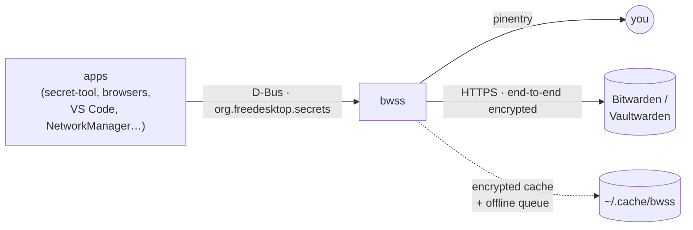

<div align="center">

# 🔐 bwss

**Your Linux keyring, in your Bitwarden vault.**

A drop-in replacement for gnome-keyring's Secret Service that keeps every
secret in Bitwarden, so it follows you to every machine like iCloud Keychain
does on a Mac.

`org.freedesktop.secrets` · Rust · Bitwarden & Vaultwarden · offline-first · per-app access control

</div>

---

Your browser, IDE, mail client, Wi-Fi manager and `git` keep their passwords
in the desktop keyring. On Linux that keyring is a file on one machine: set up
a new laptop and you start over, and lose the disk and the secrets go with it.

**bwss** implements the standard
[freedesktop Secret Service API](https://specifications.freedesktop.org/secret-service/),
so every app that already talks to gnome-keyring or KWallet works unchanged.
The storage behind it is a folder in your Bitwarden vault:

```console
$ secret-tool store --label="GitHub token" service github user me
Password: ••••••••          # first use: a pinentry dialog asks for your Bitwarden master password
$ secret-tool lookup service github
ghp_8x7…
```

…and *GitHub token* now shows up in Bitwarden on your phone, and in the
keyring of every other machine running bwss.

## ✨ Features

- **Works with your existing apps**: anything that speaks Secret Service.
  That includes libsecret (`secret-tool`, GNOME apps), Chromium and Electron
  apps such as VS Code, NetworkManager, Python `keyring`/`secretstorage`,
  and `oo7`.
- **Synced everywhere.** Items are ordinary Bitwarden logins: visible and
  editable in every Bitwarden client, and shared by every bwss instance on
  the same account.
- **Unlock once.** The first app that needs a secret pops up a pinentry
  dialog. Scripts and login hooks can use `bwss unlock --password-stdin`.
- **Per-app access control, like the macOS Keychain.** The app that created
  an item can use it freely. Any other executable triggers
  *Allow / Deny*, then *Always allow / Only this time*. The check fails
  closed: only an explicit "Allow" grants access.
- **Offline-first.** The last sync is cached, still encrypted. The keyring
  unlocks and reads with no network; writes are queued in order and
  replayed when you are back online.
- **Locked, but findable.** A locked keyring still answers searches from a
  salted attribute index, so apps trigger the unlock prompt instead of
  failing silently after a reboot.
- **Your Bitwarden data stays intact.** Editing an item keeps its username,
  URIs, custom fields, attachments and history, and the previous secret
  goes into password history.
- **Small and self-contained**: one binary, and the musl build is fully
  static (about 14 MB). It talks to Bitwarden directly, with no `bw` CLI or
  Node.js.

## 🧭 How it compares

| | gnome-keyring | KeePassXC (Secret Service) | **bwss** |
|---|---|---|---|
| Where secrets live | local keyring file | local KDBX file | **your Bitwarden vault** |
| Multi-device sync | — | sync the file yourself | **built in (Bitwarden)** |
| Phone / browser access | — | via third-party apps | **every Bitwarden client** |
| Works offline | ✓ | ✓ | ✓ (cached, queued writes) |
| Ask before another app reads a secret | — | ✓ | ✓ |
| Self-hostable server | — | — | ✓ (Vaultwarden) |

## 🏗️ How it works



| Secret Service | Bitwarden |
|---|---|
| default collection (`login`, alias `default`) | folder **`secret-service`** |
| collection "Work" | folder `secret-service/Work` |
| item label | item name |
| secret | login password (notes for very large secrets; base64 for binary data) |
| attributes (`service=github`, …) | custom fields `ss:attr:service`, … |
| `session` collection | memory only, never stored |

- **Encryption**: bwss implements Bitwarden's client-side crypto itself:
  PBKDF2 or Argon2id, HKDF, and AES-256-CBC with HMAC.
- **What goes over the network**: Bitwarden ciphertext only. Your master
  password never leaves the machine.
- **API key**: it only *authenticates*. Decrypting still needs your master
  password.

## 🚀 Quick start

**1. Build and install**

```sh
git clone <this repository> && cd bwss
cargo install --path .            # puts bwss in ~/.cargo/bin
```

**2. Connect your account.** Get a personal API key from the Bitwarden web
vault: *Settings → Security → Keys → View API key*.

```sh
bwss login --email you@example.com --client-id user.xxxxxxxx   # asks for client_secret
# Self-hosted? add: --server https://vault.example.org
```

This writes `~/.config/bwss/config.toml` and `~/.config/bwss/credentials.toml`,
both with mode `0600`. See
[`contrib/config.example.toml`](contrib/config.example.toml) for the options
(root folder, pinentry program, access control, idle lock, sync interval).

**3. Take over the keyring.** Stop gnome-keyring's secrets component (or
KWallet's or KeePassXC's integration) first, then:

```sh
install -Dm644 contrib/bwss.service ~/.config/systemd/user/bwss.service
install -Dm644 contrib/org.freedesktop.secrets.service \
  ~/.local/share/dbus-1/services/org.freedesktop.secrets.service
systemctl --user daemon-reload
systemctl --user enable --now bwss.service
```

**4. Use it.** Your apps already know how; the CLI covers the rest:

```sh
bwss status      # locked/unlocked · item count · queued offline changes
bwss unlock      # pinentry, or: bwss unlock --password-stdin
bwss lock
bwss sync        # pull changes now (otherwise every 5 minutes)
```

## 🔒 Security

- The master password is used only locally, to derive keys. Key material is
  zeroized when the keyring locks.
- HTTPS is required (plain http is accepted only for `localhost`), and
  redirects are not followed, so the API key cannot be bounced to another
  host.
- Only Bitwarden's authenticated encryption (EncString type 2) is accepted.
  Server-supplied KDF parameters are range-checked to stop downgrades and
  resource exhaustion.
- Secrets cross D-Bus encrypted whenever the client asks for it
  (`dh-ietf1024-sha256-aes128-cbc-pkcs7`, the libsecret default).
- On disk there is only Bitwarden ciphertext, plus the locked index. The
  index holds salted attribute hashes, never secrets; this is the same
  trade-off gnome-keyring makes.

What bwss is **not**: a sandbox. Per-app control identifies apps by
executable path (`/proc/<pid>/exe`), so all Python scripts share
`/usr/bin/python3`. Any process running as your user can still inspect
other processes. It stops quiet cross-app reads, not a determined local
attacker.

## 🧪 Status

bwss is **young**: tested, but not yet battle-tested. Please try it before
you trust it with secrets you cannot recover from Bitwarden itself.

| Check | Result |
|---|---|
| Unit tests (crypto known-answer vectors, mapping, sessions, keyring) | 19 ✓ on macOS, Debian (glibc, aarch64), Alpine (musl, aarch64 and x86_64) |
| End-to-end: real D-Bus, `secret-tool`, python-secretstorage (DH sessions), Vaultwarden, checked by an independent Bitwarden client | 18 ✓ |
| `cargo clippy`, `cargo audit` | clean |
| Search over 10,000 items | 0.4 ms |

**Not tested yet**: bitwarden.com itself (all server tests used
Vaultwarden), desktop apps such as Chromium and VS Code under a real
session, and end-to-end tests on x86_64.

**Roadmap**:

- a PAM module for unlock-at-login;
- the Flatpak secret portal;
- `bwss import`, to tag existing Bitwarden logins from any folder;
- organization collections;
- push updates instead of polling.

## 🛠️ Development

```sh
cargo test                                            # unit tests
cargo test --release perf -- --ignored --nocapture    # performance budgets

# End-to-end on Linux: dbus, secret-tool, python-secretstorage
docker build -t bwss-e2e tests/e2e
docker run --rm -v "$PWD":/src -v bwss-target:/target -v bwss-cargo:/usr/local/cargo/registry bwss-e2e

# …and against a throwaway Vaultwarden (the test container joins its network)
docker run -d --rm --name bw-it -e SIGNUPS_ALLOWED=true -e SIGNUPS_VERIFY=false \
  -e LOGIN_RATELIMIT_MAX_BURST=1000 -e LOGIN_RATELIMIT_SECONDS=1 \
  -e I_REALLY_WANT_VOLATILE_STORAGE=true vaultwarden/server:latest
docker run --rm --network container:bw-it -e BW_E2E_URL=http://127.0.0.1:80 \
  -v "$PWD":/src -v bwss-target:/target -v bwss-cargo:/usr/local/cargo/registry bwss-e2e
```

The full design is in [`docs/design.md`](docs/design.md): storage mapping,
locking, sessions, prompts, access control, the offline queue, the security
review and the test matrix. The original plan is in
[`docs/plan.md`](docs/plan.md).

---

<sub>bwss is an independent project. It is not affiliated with or endorsed by
Bitwarden, Inc. "Bitwarden" is a trademark of Bitwarden, Inc.</sub>
