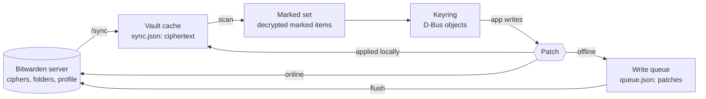
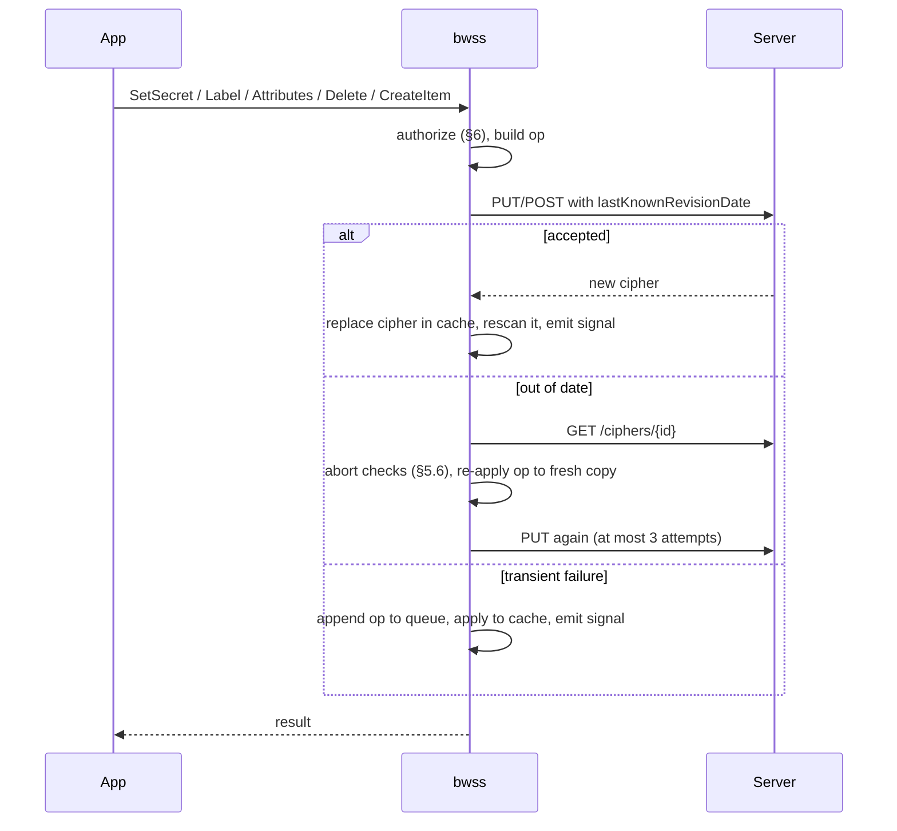

# bwss — redesign

This document describes bwss rebuilt from scratch around one idea: **a
vault item belongs to the keyring because the user marked it, not because of
where it sits.** It replaces the folder-based design on `main` (a keyring
folder plus `whole_vault`). It is written for whoever builds it. Choices the
author made without the user are marked *(builder's call, revisable)*.

## 1. Intent

bwss gives Linux the macOS Keychain experience, with Bitwarden as the store.
Every Secret Service client (libsecret and `secret-tool`, Chromium and
Electron, NetworkManager, python `keyring` and `secretstorage`, `oo7`) reads
and writes secrets that live in the user's Bitwarden vault and follow them to
every device.

The redesign exists because the user wants the **whole vault** usable from
apps, without exposing the whole vault to every process on the session bus.
The model is borrowed from the obsidian-keychain-bitwarden plugin, which
solves the same problem for Obsidian:

- any item, in any folder or none, joins the keyring when it carries the
  custom field `bwss:id`;
- unmarked items are never decrypted beyond their field names;
- bwss never overwrites data the user typed: an app's secret goes into the
  field `bwss:password`, and deleting from an app removes bwss's fields
  before it ever considers the Bitwarden trash.

### Goals

- Read and write marked items wherever they are, with the same rules for
  items bwss created and items the user marked by hand.
- Never lose user data: no app action may overwrite or trash anything the
  user put into an item.
- Keep every decision synced: ids, attributes, collections and "Always
  allow" rules travel inside the item to every device.
- Keep the keychain experience: one unlock, per-app confirmation, offline
  use, automatic sync.

### Non-goals

- Organization items and COSE (type 7) items in the first version (see §12
  for how they fit later).
- Cards, identities and SSH key items.
- A PAM module, the Flatpak secret portal, `ChangeLock`, and aliases other
  than `default`.
- Real-time sync through the notifications hub (polling stays).

### Anti-goals

These would make it a failure even if every test passed:

- Any unmarked item's name, username, URI, password or note reaching the
  bus, the cache in plain text, or a log.
- An app silently replacing a password or note the user typed, or trashing
  an item that still holds something the user put there.
- Two devices disagreeing on which items exist or what their ids are.

## 2. Vocabulary

| Term | Meaning |
|---|---|
| Marker | A custom field named `bwss:id` with a non-empty value |
| Marked item | A personal login or secure note, not trashed, carrying a marker |
| bwss field | Any custom field whose name starts with `bwss:` |
| Foreign content | Everything in an item that is not a bwss field (see §5.4) |
| Keyring folder | The folder new items are created in, `secret-service` by default |

## 3. Item model

### 3.1 Fields

| Field | Kind | Meaning |
|---|---|---|
| `bwss:id` | text | The marker and the item's stable id. bwss generates a UUID (32 hex digits) for items it creates; the user may type any value on items they mark. |
| `bwss:password` | hidden | The secret, when present and non-empty. All writes go here. |
| `bwss:label` | text | The Secret Service label, when present. Label edits go here. |
| `bwss:attr:<name>` | text | One lookup attribute each. |
| `bwss:collection` | text | Collection id; absent means `login` (alias `default`). |
| `bwss:content-type` | text | Content type of the secret; absent means `text/plain`. |
| `bwss:encoding` | text | `base64` when the stored secret is base64 of non-UTF-8 bytes. |
| `bwss:location` | text | `notes` when bwss itself moved an oversize secret into the notes (§5.2). |
| `bwss:acl` | hidden | Executables allowed without asking, one path per line. |
| `bwss:created` | text | Unix seconds when the item joined the keyring. |

Field names are matched exactly (case-sensitive). Fields with any other
`bwss:` name are kept on write but otherwise ignored, so newer versions can
add fields.

### 3.2 Reading

For a marked item:

- **Label**: `bwss:label` if non-empty, else the item name.
- **Secret**, first non-empty of:
  1. `bwss:password`;
  2. `notes`, when `bwss:location=notes` or the item is a secure note;
  3. `login.password`.

  Then base64-decode when `bwss:encoding=base64`. An empty result is a valid
  empty secret.
- **Attributes**: the `bwss:attr:*` fields, plus derived attributes that
  let a hand-marked item be found without typing attributes:
  `bwss:id`, `bwss:name` (item name), `bwss:username` and `bwss:uri` (first
  URI), each left out when empty. The `bwss:` prefix keeps ordinary app
  queries (`service=…`) from matching them by accident. A `bwss:attr:` field
  can not override a derived attribute. *(builder's call, revisable)*
- **Created / modified**: `bwss:created` (falling back to `creationDate`)
  and `revisionDate`.

### 3.3 Ids and object paths

- The id is the marker's value, trimmed. It is shared by every device
  because it is stored in the item, and Bitwarden syncs it like any field.
- The D-Bus path element is a **reversible** escape of the id: ASCII letters
  and digits stay, every other byte becomes `_xx` (lowercase hex), and `_`
  itself becomes `_5f`. Two different ids can therefore never share a path.
  UUIDs that bwss generates are unchanged by the escape.
- **Duplicate ids** (the usual cause is "Clone item" in a Bitwarden client,
  which copies the marker): the item with the oldest `creationDate`, then
  the lowest cipher id, wins on every device. The others are left out of
  the keyring, a warning is logged, and `bwss status` lists them so the
  user can fix them.

### 3.4 Unmarked items

To find markers, bwss decrypts the item key (when the item has one) and the
**names** of the custom fields, nothing else. Values, item names, notes,
logins and URIs of unmarked items stay ciphertext in memory and on disk. A
field-name decryption failure skips the item with a warning, the same as
any undecryptable item.

## 4. Collections

- Membership comes from `bwss:collection`, not from folders. Moving an item
  between folders in Bitwarden changes nothing for apps.
- Collection ids are lowercase. The field value is trimmed and lowercased;
  `default` means `login`. `session` is refused (the item stays in `login`,
  with a warning), because `session` is memory only.
- `login` (alias `default`) always exists. `session` always exists and is
  never stored.
- **Collection registry**: an app can create an empty collection, so
  collections need a record of their own. bwss keeps one secure note in the
  keyring folder, marked `bwss:id=_collections` and `bwss:kind=collections`,
  whose notes hold JSON: `{ "<id>": { "label": "...", "created": <secs> } }`.
  It is never exposed as an item. Unlike other items it is merged, never
  overwritten: several registry notes (two devices creating one while
  apart) are read as the union of their entries, and a write that hits an
  out-of-date rejection is redone on the fresh copy entry by entry. A
  deleted collection stays as `{ "deleted": true }` so a merge does not
  bring it back. *(builder's call, revisable)* The collections shown are the union of
  `login`, the registry and every collection id that marked items use.
  *(builder's call, revisable: the alternative is one sub-folder per
  collection, which is what `main` does and what this design moves away
  from.)*
- **Deleting a collection** applies the delete rule (§5.4) to every item in
  it, after authorizing each one, then removes its registry entry. `login`
  and `session` can not be deleted.

## 5. Writing

All writes go through one rule: **bwss changes only bwss fields of an item
it did not create, and only touches the rest of an item when every part it
touches is its own.**

### 5.1 Creating an item

- `CreateItem` makes a **secure note** in the keyring folder, named after
  the label, with empty notes, and the fields `bwss:id` (new UUID),
  `bwss:password`, `bwss:attr:*`, `bwss:collection` (unless `login`),
  `bwss:content-type` (unless `text/plain`), `bwss:acl` (the creator) and
  `bwss:created`. *(builder's call, revisable: `main` creates logins; a
  login with an empty password would show up in browser autofill for no
  reason.)*
- `replace=true` looks for an item in the same collection with exactly the
  same `bwss:attr:*` attributes (derived attributes do not count) and
  updates it instead.
- The keyring folder is created on first need, matched by exact name; with
  duplicate folder names the lowest id wins.

### 5.2 Changing the secret

- The new value goes into `bwss:password` (hidden). The login password,
  the notes and the password history are left alone.
- Non-UTF-8 bytes are stored as base64 with `bwss:encoding=base64`;
  otherwise `bwss:encoding` is removed.
- **Size**: Bitwarden limits a field value to 5,000 encrypted characters
  and the notes to 10,000. When the encrypted secret does not fit a field:
  - if the notes are empty or already hold bwss's secret
    (`bwss:location=notes`), it goes into the notes with
    `bwss:location=notes`, and `bwss:password` is removed;
  - otherwise the write fails with an error: bwss never overwrites notes
    the user wrote.
  - Above 10,000 the write fails.

### 5.3 Changing the label or attributes

- Label: written to `bwss:label`. The item name is left alone, except on
  creation.
- Attributes: the `bwss:attr:*` set is replaced as a whole. Derived
  attributes can not be set.

### 5.4 Deleting an item

1. Remove every bwss field. When `bwss:location=notes`, clear the notes too
   (they hold bwss's secret).
2. If what remains has **no foreign content**, move the item to the
   Bitwarden trash (restorable for 30 days). Otherwise save it, and it
   simply leaves the keyring.

Foreign content is any of: a non-empty login username, password, TOTP or
URI; non-empty notes; a custom field whose name does not start with
`bwss:`; an attachment; a passkey (`login.fido2Credentials`); a non-empty
password history. The item name alone does not count.

The decision is made against the server's copy, never a stale one:
step 1 is saved first with `lastKnownRevisionDate`, and step 2 looks at
what the server returned. If the save is rejected as out of date, bwss
refetches and starts over at step 1 (a user edit made elsewhere in the
meantime therefore keeps the item). A delete waiting in the offline queue
is stored as "delete item X", not as "trash X", and runs these same steps
when replayed. *(builder's call, revisable)*

An item bwss created and nobody edited therefore goes to the trash; a login
the user marked by hand keeps its password and only loses its bwss fields.
Removing all bwss fields, not just `bwss:password`, matters: otherwise the
item would stay in the keyring with its old login password and the app
would find it again after "deleting" it.

### 5.5 Passing items through

Every write sends the item as the server last returned it, minus
response-only metadata, so unknown properties, attachments, URIs, passkeys
and foreign fields survive. It keeps the per-item key (`cipher.key`) and
sends `lastKnownRevisionDate` and `encryptedFor`.

### 5.6 Conflicts

When the server rejects a write as out of date, bwss refetches the item and
re-applies **its own field changes** to the fresh copy, then retries once
more. Because bwss only edits bwss fields (and a creation's own notes),
edits made elsewhere to the rest of the item are never clobbered. If both
sides changed the same bwss field, bwss's write wins, except:

- `bwss:acl` merges as the union of lines, so an "Always allow" given on
  another device survives;
- the retry is abandoned, with an error to the app, when the fresh copy is
  trashed or deleted, no longer carries the same `bwss:id`, or now has
  notes where bwss meant to put an oversize secret. bwss never re-marks an
  item the user unmarked.

*(builder's call, revisable: a three-way merge with a conflict prompt, as
the Obsidian plugin does, is possible later.)*

## 6. Access control

- Every read of a secret (`GetSecret(s)`), every change (`SetSecret`,
  `Label`, `Attributes`, `CreateItem` with `replace`) and every delete
  checks the caller's executable (`/proc/<pid>/exe` of the bus peer)
  against `bwss:acl`. Anyone else gets a fail-closed pinentry confirmation:
  "Allow / Deny", then "Always allow / Only this time". Only an explicit OK
  grants anything.
- "Always allow" appends to `bwss:acl` in the item, so it syncs. A
  hand-marked item starts with no ACL: every app is asked the first time.
- `acl = "off"` disables checks (gnome-keyring behaviour). The `session`
  collection is exempt.
- Labels and attributes of marked items are readable by any process on the
  bus while unlocked; that is how the Secret Service API works. This is why
  marking is opt-in: the user decides which items' metadata apps may see.
- Limits, as before: same-user processes can ptrace each other, and
  interpreters share one identity. This is a speed bump, not a sandbox.

## 7. Unlocking, locking and the locked index

Unchanged from `main`:

- One Bitwarden master password unlocks everything, through pinentry (3
  attempts) on the first request or `bwss unlock`. Failed CLI unlocks are
  delayed 2 s.
- Lock on request, after `idle_lock_minutes`, and on SIGTERM: keys and
  decrypted items are zeroized, the API session is dropped.
- The locked index (`~/.cache/bwss/locked-index.json`) keeps, per marked
  item, its id, its collection and SHA-256(salt ‖ name ‖ 0 ‖ value) of each
  attribute (derived ones included), with a random per-install salt, so
  libsecret can find and unlock a locked item after a restart. It covers
  marked items only.

## 8. Data model and sync

### 8.1 Data model

Three layers, from the server inward:



**Vault cache** (`~/.cache/bwss/sync.json`, mode 0600). The last `/sync`
response as the server sent it, so everything in it is still ciphertext,
plus the KDF parameters and the account revision date. Every successful
write replaces the cipher it touched with the server's answer. It is the
only copy of the vault on disk and the source for offline unlock.

**Marked set** (memory only, while unlocked). Built by scanning the cache:

```
MarkedItem {
  cipher_id, revision_date        // which server object, which version
  id                              // value of bwss:id
  collection, label, attributes   // explicit bwss:attr:* + derived
  secret: Zeroizing<Vec<u8>>, content_type
  secret_source: Field | BwssNotes | NoteBody | LoginPassword
  acl: Vec<String>, created, modified
}
duplicates: Vec<(id, cipher_ids)>
registry: BTreeMap<collection id, { label, created, deleted }>
```

`secret_source` records where the secret was read from (§3.2), so a write
knows which part it may replace. A per-cipher scan cache keyed by
`(cipher_id, revision_date)` remembers "unmarked" for ciphers that have not
changed, so a refresh only decrypts field names of changed ciphers.

**Keyring** (memory only). The Secret Service view: collections and items
keyed by `id`, the escaped object paths, and the locked index. It knows
nothing about Bitwarden.

**Patch**: every write, online or queued, is expressed as a change to
bwss's own parts of one item, never as a whole item body:

```
Op =
  | Create  { id, collection, body }            // the full new secure note
  | Patch   { id, base_revision,
              set: [(field, value, hidden)],    // bwss fields to write
              remove: [field],                  // bwss fields to drop
              notes: Keep | Set(v) | Clear }    // only for bwss's own notes
  | Delete  { id, base_revision }               // §5.4, decided on replay
  | Registry{ collection, entry }               // merged, §4
```

An op names its item by `id`, not by cipher id, because a queued create
has no cipher id yet. The cipher id is looked up when the op runs.

**Write queue** (`~/.local/state/bwss/queue.json`, mode 0600). The ordered
list of ops not yet accepted by the server. Field names, field values,
ids and labels are stored as EncStrings under the user key; only op kinds,
cipher ids (already plain in the cache) and revision dates are plain. A
queued op is applied to the cache right away, so reads on this device see
it before the server does.

**Locked index** (`~/.cache/bwss/locked-index.json`), as in §7.

### 8.2 Unlocking

1. Online: prelogin (KDF parameters), API-key login, `GET /sync`, decrypt
   the user key with the master key. Save the response as the cache.
2. Offline, when step 1 fails transiently (connection errors, 429, 5xx):
   load the cache instead. The password check is identical (the MAC of the
   protected user key).
3. Re-apply every queued op to the loaded cache, so pending writes stay
   visible.
4. Scan: for every personal login or secure note not in the trash, decrypt
   the item key and the field names; for marked ones, decrypt the rest and
   build a `MarkedItem`. Resolve duplicate ids (§3.3). Read the registry.
5. Build the keyring and the locked index, and flush the queue in the
   background.

### 8.3 Writing



- Applying an op always means: take the current copy of the cipher (the
  server's on retry or flush, the cache's when queuing), apply the op's
  field changes and merges (`bwss:acl` union, registry union), run the
  abort checks, and send the result.
- Once an op is queued, later ops for any item queue behind it, so order
  is kept across items. *(builder's call, revisable: ordering per item
  would let unrelated writes through sooner.)*
- A `Delete` saves the stripped item first and trashes it only if the
  server's answer holds no foreign content (§5.4).
- A permanent error (4xx other than out-of-date and 429) drops the op,
  logs it and rescans the item from the server, so the local view returns
  to the truth.

### 8.4 Refreshing

Every `sync_interval_seconds` (default 300), on `bwss sync`, and right after
an unlock:

1. Flush the queue in order. A transient failure stops the flush; the rest
   stays queued.
2. `GET /accounts/revision-date`. If it equals the cached one, stop here.
   *(builder's call, revisable: this saves a full `/sync` on most ticks.)*
3. `GET /sync`, replace the cache, re-apply ops still queued.
4. Rescan, only changed ciphers (§8.1), and diff the marked set by `id`:
   - new id: `ItemCreated` (this includes an item the user just marked);
   - id gone: `ItemDeleted` (unmarked, trashed or deleted elsewhere);
   - same id, new revision: `ItemChanged`;
   - collections appearing or disappearing: `CollectionCreated` /
     `CollectionDeleted`.
5. Rewrite the locked index.

No sync happens while locked: the user key and the API token are gone.

### 8.5 Across devices

- Everything apps can see lives in the item: id, label, attributes,
  collection, content type, ACL, and the secret. Two devices that have
  both synced therefore show the same keyring.
- Until the next refresh, a device does not see another device's changes
  (up to `sync_interval_seconds`).
- Two devices creating the same item while apart produce two items with
  different ids, and apps searching by attributes see two matches. bwss
  does not merge them; `bwss status` lists items with identical collection
  and `bwss:attr:*` sets.
- Concurrent edits of the same item merge field by field (§5.6); the
  registry and `bwss:acl` merge as unions.

## 9. Sessions, prompts and the bus

Unchanged from `main`: `plain` and `dh-ietf1024-sha256-aes128-cbc-pkcs7`
sessions owned by the opening bus name (at most 4,096); pinentry over
Assuan with 120 s timeouts; `Prompt.Completed` carries a result of the
success type even when dismissed; `org.freedesktop.secrets` requested with
`DO_NOT_QUEUE | ALLOW_REPLACEMENT` (plus `REPLACE_EXISTING` with
`--replace`); the control interface `io.github.dynamotn.bwss.Control1`.

## 10. Configuration and CLI

```toml
backend = "bitwarden"            # or "memory" for tests and demos
server_url = "https://vault.bitwarden.com"
email = "you@example.com"
folder = "secret-service"        # where new items are created
prompter = "pinentry"
acl = "prompt"                   # or "off"
idle_lock_minutes = 0
sync_interval_seconds = 300
```

`whole_vault` is gone: the marker replaces it. `deny_unknown_fields` stays,
so an old config with `whole_vault` fails loudly at start.

```
bwss daemon [--replace]
bwss unlock [--password-stdin]
bwss lock | sync | status
bwss login --email E [--server URL] --client-id ID [--client-secret-stdin]
```

`bwss status` additionally reports duplicate ids and likely duplicate items
(§3.3, §8), by id and label only, never secrets.

## 11. Security model

| Asset | Protection |
|---|---|
| Unmarked items | Only field names are decrypted; nothing reaches the bus, the index or logs |
| Marked items' metadata | On the bus while unlocked, by the user's choice (marking) |
| Secrets | ACL plus fail-closed confirmation; DH-AES sessions on the bus |
| User data in marked items | Writes touch bwss fields only; trash only when no foreign content is left |
| Master password, user key | Local only, zeroized, dropped on lock |
| API key | 0600 file, https only except loopback, redirects disabled |
| Disk | Bitwarden ciphertext only (cache, queue); hashed locked index |
| Server input | KDF bounds, MAC checked before decrypt, error text clipped |

Notes:

- The marker is ciphertext under the user key, so the server can not mark
  a personal item on its own. (For organization items it could, through
  any member with write access; see §12.)
- `bwss:acl` comes from the item. Anyone who can edit the item in
  Bitwarden can grant an executable access; for personal items that is the
  user.

## 12. Later: organization items

Left out of the first version, but the design should not block it:

- Organization keys are RSA-OAEP encrypted to the user's public key; the
  private key is in `profile.privateKey`, encrypted with the user key. Use
  an RSA implementation without RUSTSEC-2023-0071 (for example
  `aws-lc-rs`), not the `rsa` crate.
- Opt-in per organization in the config, because any member with write
  access to a shared item could mark it, set its `bwss:acl`, or change its
  `bwss:password`. For organization items, `bwss:acl` should not grant
  access without a local confirmation.

## 13. Architecture

The module split of `main` is kept. The builder may port code from `main`
(crypto, API client, sessions, pinentry, ACL identity, D-Bus objects,
config, fsutil), since none of those change in substance.

| Module | Change from `main` |
|---|---|
| `bw/crypto.rs` | Unchanged |
| `bw/api.rs` | Adds `GET /ciphers/{id}` and `GET /accounts/revision-date`; folder writes are only needed for the keyring folder |
| `bw/items.rs` | Rewritten: marker scan (field names only), the read and write rules of §3 and §5, foreign-content check, field-level re-apply on conflict |
| `backend/bitwarden.rs` | Snapshot built from marked items and the collection registry; no sub-folders, no `whole_vault`, no `vault-acl` |
| `model.rs` | No `read_only`; reversible path escape |
| `daemon.rs`, `dbus.rs` | No `vault` collection or read-only checks; delete calls the §5.4 rule |
| `keyring.rs`, `session.rs`, `prompter.rs`, `acl.rs`, `config.rs`, `fsutil.rs`, `main.rs` | Unchanged apart from removing `whole_vault` |

## 14. Compatibility with `main`

None, by decision. There is no migration and no special case for items or
files that `main` wrote:

- Items `main` created carry `bwss:id`, so they are simply marked items
  under the rules above. Their secret is read from `login.password` or the
  notes, which now count as foreign content: an app's next write goes to
  `bwss:password` and leaves the old value in place, and a delete strips
  the bwss fields and keeps the item. Users who want a clean start delete
  those items, or their bwss fields, by hand.
- Collections `main` built from sub-folders are not recognised; their
  items show up in `login` until they get `bwss:collection`.
- `whole_vault` is an unknown config key and stops the daemon at start.
- The cache, queue and locked index keep their paths but carry
  `"format": 2`. A file without it (left by `main`) is not read: the cache
  and the index are rebuilt, and a queue is renamed `queue.json.main` with
  a warning, never replayed. `vault-acl` is not read.

## 15. Verification

- **Unit tests** for each rule here, in particular:
  - reading precedence (label, secret), derived attributes;
  - unmarked items: only field names decrypted (assert that decrypting the
    name, notes or login of an unmarked cipher never happens, for example
    with a counting key in tests);
  - path escape is reversible and collision-free;
  - duplicate ids resolved the same way regardless of order;
  - writes leave foreign content and history untouched; size fallback to
    notes and its refusal when the notes hold user text;
  - delete: trash versus strip, for each kind of foreign content;
  - conflict re-apply keeps a concurrent foreign edit;
  - the collection registry round trip.
- **End-to-end** (pytest under `dbus-run-session`, against Vaultwarden,
  checked by the independent Python client in `tests/e2e/bwclient.py`):
  - an item marked by the other client appears after `bwss sync`, findable
    by `bwss:name`, and an app write lands in `bwss:password` while the
    login password stays;
  - deleting a hand-marked login strips bwss fields and keeps the item;
    deleting an item bwss created trashes it;
  - unmarking in the other client removes it from the keyring;
  - a cloned item does not change which item apps see;
  - all existing scenarios from `main` (unlock, ACL, offline queue,
    locked index, collections, sessions).
- `cargo fmt --check`, `cargo clippy --locked --all-targets`,
  `cargo test --locked`, the ignored perf test, and `cargo audit`.

## 16. Left to the builder

- Internal structure inside each module, error types, log wording.
- Exact layout of `bwss status` output.
- Whether to port code from `main` or rewrite it, module by module.
