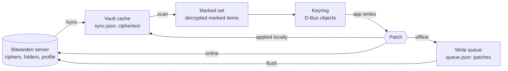
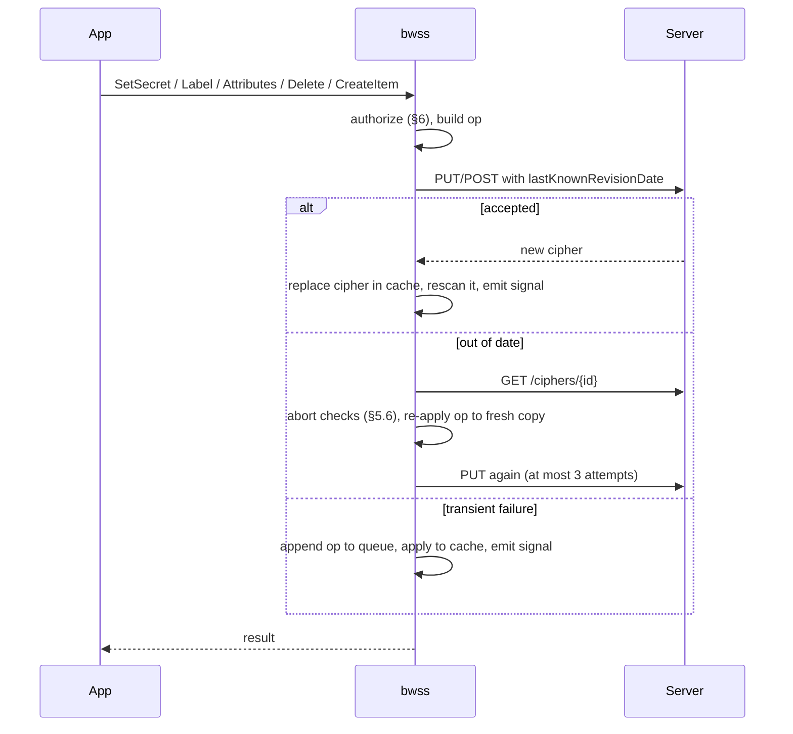

# bwss — redesign

This design follows the **dybw data model, version 1**
(`docs/data-model.md` in the dybw umbrella repository). That spec is
normative and wins over this document; this document adds the `bwss`
namespace's own rules (its fields are registered in dybw's
`docs/namespaces.md`). A change to a shared rule goes through a dybw ADR,
then the spec, then this document. Section references written "spec §n"
point into the data model.

This document describes bwss rebuilt from scratch around one idea: **a
vault item belongs to the keyring because the user marked it, not because of
where it sits.** It replaces the folder-based design now on the `legacy`
branch (a keyring folder plus `whole_vault`). It is written for whoever
builds it. Choices the author made without the user are marked
*(builder's call, revisable)*.

## 1. Intent

bwss gives Linux the macOS Keychain experience, with Bitwarden as the store.
Every Secret Service client (libsecret and `secret-tool`, Chromium and
Electron, NetworkManager, python `keyring` and `secretstorage`, `oo7`) reads
and writes secrets that live in the user's Bitwarden vault and follow them to
every device.

The redesign exists because the user wants the **whole vault** usable from
apps, without exposing the whole vault to every process on the session bus.
The model is borrowed from the obsidian-keychain-bitwarden plugin, which
solves the same problem for Obsidian:

- any item, in any folder or none, joins the keyring when it carries the
  custom field `bwss:id`;
- unmarked items are never decrypted beyond their field names;
- a changed secret is written back where it was read (spec §6.1), so a
  hand-marked login stays the one source for the browser, the official
  clients and apps; a new secret never lands in a password or notes the
  user owns;
- deleting from an app removes bwss's fields before it ever considers the
  Bitwarden trash.

### Goals

- Read and write marked items wherever they are, with the same rules for
  items bwss created and items the user marked by hand.
- Never lose user data: no app action may overwrite or trash anything the
  user put into an item.
- Keep every decision synced: ids, attributes, collections and "Always
  allow" rules travel inside the item to every device.
- Keep the keychain experience: one unlock, per-app confirmation, offline
  use, automatic sync.

### Non-goals

- Organization items and COSE (type 7) items in the first version (see §12
  for how they fit later).
- Cards, identities and SSH key items.
- A PAM module, the Flatpak secret portal, `ChangeLock`, and aliases other
  than `default`.
- Real-time sync through the notifications hub (polling stays).

### Anti-goals

These would make it a failure even if every test passed:

- Any unmarked item's name, username, URI, password or note reaching the
  bus, the cache in plain text, or a log.
- An app writing outside bwss's fields and the value source of the item
  it read, putting a new secret into a password or notes the user owns, or
  trashing an item that still holds something the user put there.
- Two devices disagreeing on which items exist or what their ids are.

## 2. Vocabulary

| Term | Meaning |
|---|---|
| Marker | A custom field named `bwss:id` with a non-empty value after trimming |
| Marked item | A personal login or secure note, not trashed, carrying a marker |
| bwss field | Any custom field whose name starts with `bwss:` |
| Value source | Where a marked item's secret was read from (§3.2, spec §5) |
| Foreign content | Everything in an item that is not a bwss field (see §5.4), including other tools' fields |
| Keyring folder | The folder new items are created in, `secret-service` by default |

## 3. Item model

### 3.1 Fields

| Field | Kind | Meaning |
|---|---|---|
| `bwss:id` | text | The marker and the item's stable id. bwss generates a UUID (32 hex digits) for items it creates; the user may type any value on items they mark. |
| `bwss:password` | hidden | Holds the secret when the field is present, even empty. New items keep their secret here. |
| `bwss:label` | text | The Secret Service label, when present. Label edits go here. |
| `bwss:attr:<name>` | text | One lookup attribute each. |
| `bwss:collection` | text | Collection id; absent means `login` (alias `default`). |
| `bwss:content-type` | text | Content type of the secret; absent means `text/plain`. |
| `bwss:encoding` | text | `base64` when the stored secret is base64 of non-UTF-8 bytes. |
| `bwss:location` | text | `notes` when bwss itself moved an oversize secret into the notes (§5.2). |
| `bwss:acl` | hidden | Executables allowed without asking, one path per line. |
| `bwss:created` | text | Unix seconds when the item joined the keyring. |

Field names are matched exactly (case-sensitive). If an item carries the
same field twice, the first in field order counts, and a write changes only
that one (spec §3.1). Every field bwss does not own is kept on write: other
namespaces (`obsidian:*`, the reserved `dybw:*`), fields with no namespace,
and `bwss:` fields this version does not know, so newer versions can add
some.

### 3.2 Reading

For a marked item:

- **Label**: `bwss:label` if non-empty, else the item name.
- **Secret** (spec §5), from the first **present** source:
  1. the `bwss:password` field, when it exists, even with an empty value;
  2. the notes, when `bwss:location=notes`;
  3. `login.password` for a login, the notes for a secure note.

  Then base64-decode when `bwss:encoding=base64`. An empty result is a valid
  empty secret. bwss remembers the value source of each item; presence, not
  content, decides step 1, so the source does not change when a value
  becomes empty.
- **Attributes**: the `bwss:attr:*` fields, plus derived attributes that
  let a hand-marked item be found without typing attributes:
  `bwss:id`, `bwss:name` (item name), `bwss:username` and `bwss:uri` (first
  URI), each left out when empty. The `bwss:` prefix keeps ordinary app
  queries (`service=…`) from matching them by accident. A `bwss:attr:` field
  can not override a derived attribute. *(builder's call, revisable)*
- **Created / modified**: `bwss:created` (falling back to `creationDate`)
  and `revisionDate`.

### 3.3 Ids and object paths

- The id is the marker's value, trimmed. It is shared by every device
  because it is stored in the item, and Bitwarden syncs it like any field.
- The D-Bus path element is a **reversible** escape of the id: ASCII letters
  and digits stay, every other byte becomes `_xx` (lowercase hex), and `_`
  itself becomes `_5f`. Two different ids can therefore never share a path.
  UUIDs that bwss generates are unchanged by the escape.
- **Duplicate ids** (the usual cause is "Clone item" in a Bitwarden client,
  which copies the marker), spec §7: a personal item over an organization
  item (once those are read, §12), then the oldest `creationDate` (an item
  without one sorts last), then the lowest cipher id, wins on every
  device. The others are left out of
  the keyring, a warning is logged, and `bwss status` lists them so the
  user can fix them.

### 3.4 Unmarked items

To find markers, bwss decrypts the item key (when the item has one) and the
**names** of the custom fields, nothing else (spec §4). Values, item names,
notes, logins and URIs of unmarked items stay ciphertext in memory and on
disk.

An item bwss cannot inspect (a key it cannot unwrap, field names it cannot
decrypt, a newer ciphertext format, an organization item) is skipped with a
warning but is **not** treated as deleted: if it was in the keyring before
a refresh, it stays there as last read, without `ItemDeleted`, until it can
be read again or the keyring is locked. Marked items of another type
(card, identity, SSH key) are skipped and reported, as are items with a
`bwss:location` or `bwss:encoding` value this version does not know.

## 4. Collections

- Membership comes from `bwss:collection`, not from folders. Moving an item
  between folders in Bitwarden changes nothing for apps.
- Collection ids are lowercase. The field value is trimmed and lowercased;
  `default` means `login`. `session` is refused (the item stays in `login`,
  with a warning), because `session` is memory only.
- `login` (alias `default`) always exists. `session` always exists and is
  never stored.
- **Collection registry**: an app can create an empty collection, so
  collections need a record of their own. bwss keeps one secure note in the
  keyring folder, marked `bwss:id=_collections` and `bwss:kind=collections`,
  whose notes hold JSON: `{ "<id>": { "label": "...", "created": <secs> } }`.
  It is never exposed as an item. Unlike other items it is merged, never
  overwritten: several registry notes (two devices creating one while
  apart) are read as the union of their entries, and a write that hits an
  out-of-date rejection is redone on the fresh copy entry by entry. A
  deleted collection stays as `{ "deleted": true }` so a merge does not
  bring it back. *(builder's call, revisable)* The collections shown are the union of
  `login`, the registry and every collection id that marked items use.
  *(builder's call, revisable: the alternative is one sub-folder per
  collection, which is what `legacy` does and what this design moves away
  from.)*
- **Deleting a collection** applies the delete rule (§5.4) to every item in
  it, after authorizing each one, then removes its registry entry. `login`
  and `session` can not be deleted.

## 5. Writing

All writes go through one rule (spec §6.3, invariant 2): **bwss changes
only its own fields and the value source of the item it read.** Everything
else passes through unchanged.

### 5.1 Creating an item

- `CreateItem` makes a **secure note** (spec §6.2) in the keyring folder,
  personal (`organizationId: null`), named after the label, with empty
  notes and no login, and the fields `bwss:id` (new UUID), `bwss:password`
  (hidden, never the notes), `bwss:attr:*`, `bwss:collection` (unless
  `login`), `bwss:content-type` (unless `text/plain`), `bwss:acl` (the
  creator) and `bwss:created`.
- `replace=true` looks for an item in the same collection with exactly the
  same `bwss:attr:*` attributes (derived attributes do not count) and
  updates it instead.
- The keyring folder is created on first need, matched by exact name; with
  duplicate folder names the lowest id wins.

### 5.2 Changing the secret

- The new value goes back to the **value source** it was read from
  (spec §6.1):
  - `bwss:password`: the field is updated; the login password, the notes
    and the password history are left alone;
  - the notes (`bwss:location=notes`, or a secure note without
    `bwss:password`): the notes are updated;
  - `login.password`: the password is updated the way the official clients
    do it: the old password goes first into `passwordHistory` (at most 5
    entries) and `login.passwordRevisionDate` is set.

  So an app rotating the token of a hand-marked login updates that login,
  and the browser and the official clients see the new value. A user who
  wants an app-only value adds a `bwss:password` field to the item.
- Non-UTF-8 bytes are stored as base64 with `bwss:encoding=base64`;
  otherwise `bwss:encoding` is removed.
- **Size** (spec §6.4): Bitwarden limits a field value to 5,000 encrypted
  characters, the login password to 5,000 and the notes to 10,000. A
  value that does not fit `login.password` fails. When a value whose
  source is `bwss:password` does not fit the field:
  - if the notes are empty or already hold bwss's secret
    (`bwss:location=notes`), it goes into the notes with
    `bwss:location=notes`, and `bwss:password` is removed;
  - otherwise the write fails with an error: bwss never overwrites notes
    the user wrote.
  - Above 10,000 the write fails.

### 5.3 Changing the label or attributes

- Label: written to `bwss:label`. The item name is left alone, except on
  creation.
- Attributes: the `bwss:attr:*` set is replaced as a whole. Derived
  attributes can not be set.

### 5.4 Deleting an item

1. Remove every bwss field. When `bwss:location=notes`, clear the notes too
   (they hold bwss's secret).
2. If what remains has **no foreign content**, move the item to the
   Bitwarden trash (restorable for 30 days). Otherwise save it, and it
   simply leaves the keyring.

Foreign content (spec §8.2) is any of: a non-empty login username,
password, TOTP or URI; non-empty notes; a custom field of **another
namespace** (for example `obsidian:id`) or with no namespace; an
attachment; a passkey (`login.fido2Credentials`); a non-empty password
history. The item name alone does not count. An item another tool also
marked is therefore never trashed by bwss.

The decision is made against the server's copy, never a stale one:
step 1 is saved first with `lastKnownRevisionDate`, and step 2 looks at
what the server returned (spec §8.2). If the save is rejected as out of
date, bwss refetches and starts over at step 1 (a user edit made elsewhere
in the meantime therefore keeps the item). A delete waiting in the offline
queue is stored as "delete item X", not as "trash X", and runs these same
steps when replayed.

An item bwss created and nobody edited therefore goes to the trash; a login
the user marked by hand keeps its password and only loses its bwss fields.
Removing all bwss fields, not just `bwss:password`, matters: otherwise the
item would stay in the keyring with its old login password and the app
would find it again after "deleting" it.

### 5.5 Passing items through

Every write (spec §6.3) starts from the cipher exactly as the server last
returned it and removes only response-only metadata (`id`, `revisionDate`,
`creationDate`, `deletedDate`, `object`, `edit`, `viewPassword`,
`permissions`, `collectionIds`, `attachments`, `organizationUseTotp`,
`data`). Unknown properties (newer item types, archive state), passkeys,
URIs, TOTP, the folder and other tools' fields survive. It keeps the item
key (`cipher.key`) and encrypts under it, always sends `passwordHistory`
back (the server replaces it with what it receives), and sends
`lastKnownRevisionDate` and `encryptedFor`.

### 5.6 Conflicts

When the server rejects a write as out of date (spec §6.5), bwss refetches
the item and re-applies **its own changes** (never a stale whole body) to
the fresh copy, then retries. Edits made elsewhere to parts bwss is not
changing are never clobbered. Then:

- if the **value source** changed on the server since bwss read it, bwss
  does not overwrite it: the write fails with an error to the app, and the
  next refresh shows the server's value. *(builder's call, revisable:
  Secret Service has no conflict UI, so failing is the only policy offered;
  the spec also allows a user-chosen policy.)*
- `bwss:acl` merges as the union of lines, so an "Always allow" given on
  another device survives;
- other bwss fields changed on both sides take bwss's value;
- the retry is abandoned, with an error to the app, when the fresh copy is
  trashed or deleted, no longer carries the same `bwss:id`, or now has
  notes where bwss meant to put an oversize secret. bwss never re-marks an
  item the user unmarked.

## 6. Access control

- Every read of a secret (`GetSecret(s)`), every change (`SetSecret`,
  `Label`, `Attributes`, `CreateItem` with `replace`) and every delete
  checks the caller's executable (`/proc/<pid>/exe` of the bus peer)
  against `bwss:acl`. Anyone else gets a fail-closed pinentry confirmation:
  "Allow / Deny", then "Always allow / Only this time". Only an explicit OK
  grants anything.
- "Always allow" appends to `bwss:acl` in the item, so it syncs. A
  hand-marked item starts with no ACL: every app is asked the first time.
- `acl = "off"` disables checks (gnome-keyring behaviour). The `session`
  collection is exempt.
- Labels and attributes of marked items are readable by any process on the
  bus while unlocked; that is how the Secret Service API works. This is why
  marking is opt-in: the user decides which items' metadata apps may see.
- Limits, as before: same-user processes can ptrace each other, and
  interpreters share one identity. This is a speed bump, not a sandbox.

## 7. Unlocking, locking and the locked index

Unchanged from `legacy`:

- One Bitwarden master password unlocks everything, through pinentry (3
  attempts) on the first request or `bwss unlock`. Failed CLI unlocks are
  delayed 2 s.
- Lock on request, after `idle_lock_minutes`, and on SIGTERM: keys and
  decrypted items are zeroized, the API session is dropped.
- The locked index (`~/.cache/bwss/locked-index.json`) keeps, per marked
  item, its id, its collection and SHA-256(salt ‖ name ‖ 0 ‖ value) of each
  attribute (derived ones included), with a random per-install salt, so
  libsecret can find and unlock a locked item after a restart. It covers
  marked items only.

## 8. Data model and sync

### 8.1 Data model

Three layers, from the server inward:



**Vault cache** (`~/.cache/bwss/sync.json`, mode 0600). The last `/sync`
response as the server sent it, so everything in it is still ciphertext,
plus the KDF parameters and the account revision date. Every successful
write replaces the cipher it touched with the server's answer. It is the
only copy of the vault on disk and the source for offline unlock.

**Marked set** (memory only, while unlocked). Built by scanning the cache:

```
MarkedItem {
  cipher_id, revision_date        // which server object, which version
  id                              // value of bwss:id
  collection, label, attributes   // explicit bwss:attr:* + derived
  secret: Zeroizing<Vec<u8>>, content_type
  secret_source: Field | BwssNotes | NoteBody | LoginPassword
  secret_mark                     // keyed fingerprint of the stored value
  acl: Vec<String>, created, modified
}
duplicates: Vec<(id, cipher_ids)>
registry: BTreeMap<collection id, { label, created, deleted }>
```

`secret_source` records the value source (§3.2), so a write knows which
part it may replace. `secret_mark` is HMAC-SHA256 of the stored value under
a key derived from the user key (HKDF, purpose `value-mark`), so a retry
can tell whether the value source changed on the server (§5.6) without
keeping a second copy of the value (spec §10). A per-cipher scan cache keyed by
`(cipher_id, revision_date)` remembers "unmarked" for ciphers that have not
changed, so a refresh only decrypts field names of changed ciphers.

**Keyring** (memory only). The Secret Service view: collections and items
keyed by `id`, the escaped object paths, and the locked index. It knows
nothing about Bitwarden.

**Patch**: every write, online or queued, is expressed as a change to
bwss's own parts of one item, never as a whole item body:

```
Op =
  | Create  { id, collection, body }            // the full new secure note
  | Patch   { id, base_revision,
              set: [(field, value, hidden)],    // bwss fields to write
              remove: [field],                  // bwss fields to drop
              value: Keep                       // or write the value source:
                   | Set { source, value, base_mark } // §5.2; base_mark
                                                // detects a changed source
                   | ClearBwssNotes }           // delete, bwss:location=notes
  | Delete  { id, base_revision }               // §5.4, decided on replay
  | Registry{ collection, entry }               // merged, §4
```

An op names its item by `id`, not by cipher id, because a queued create
has no cipher id yet. The cipher id is looked up when the op runs.

**Write queue** (`~/.local/state/bwss/queue.json`, mode 0600). The ordered
list of ops not yet accepted by the server. Field names, field values,
ids, labels and values are stored as EncStrings under the user key; only
op kinds, value-source kinds, marks, cipher ids (already plain in the
cache) and revision dates are plain. The queue, the cache and the locked
index are device state (spec §10): they are never synced or copied to
another device. A
queued op is applied to the cache right away, so reads on this device see
it before the server does.

**Locked index** (`~/.cache/bwss/locked-index.json`), as in §7.

### 8.2 Unlocking

1. Online: prelogin (KDF parameters), API-key login, `GET /sync`, decrypt
   the user key with the master key. Save the response as the cache.
2. Offline, when step 1 fails transiently (connection errors, 429, 5xx):
   load the cache instead. The password check is identical (the MAC of the
   protected user key).
3. Re-apply every queued op to the loaded cache, so pending writes stay
   visible.
4. Scan: for every personal login or secure note not in the trash, decrypt
   the item key and the field names; for marked ones, decrypt the rest and
   build a `MarkedItem`. Resolve duplicate ids (§3.3). Read the registry.
5. Build the keyring and the locked index, and flush the queue in the
   background.

### 8.3 Writing



- Applying an op always means: take the current copy of the cipher (the
  server's on retry or flush, the cache's when queuing), run the abort
  checks (including the `base_mark` check on the value source), apply the
  op's field changes and merges (`bwss:acl` union, registry union), write
  the value source with password history when it is the login password,
  and send the result.
- Once an op is queued, later ops for any item queue behind it, so order
  is kept across items. *(builder's call, revisable: ordering per item
  would let unrelated writes through sooner.)*
- A `Delete` saves the stripped item first and trashes it only if the
  server's answer holds no foreign content (§5.4).
- A permanent error (4xx other than out-of-date and 429) drops the op,
  logs it and rescans the item from the server, so the local view returns
  to the truth.

### 8.4 Refreshing

Every `sync_interval_seconds` (default 300), on `bwss sync`, and right after
an unlock:

1. Flush the queue in order. A transient failure stops the flush; the rest
   stays queued.
2. `GET /accounts/revision-date`. If it equals the cached one, stop here.
   *(builder's call, revisable: this saves a full `/sync` on most ticks.)*
3. `GET /sync`, replace the cache, re-apply ops still queued.
4. Rescan, only changed ciphers (§8.1), and diff the marked set by `id`:
   - new id: `ItemCreated` (this includes an item the user just marked);
   - id gone: `ItemDeleted` (unmarked, trashed or deleted elsewhere), but
     not for an item that became uninspectable (§3.4);
   - same id, new revision: `ItemChanged`;
   - collections appearing or disappearing: `CollectionCreated` /
     `CollectionDeleted`.
5. Rewrite the locked index.

No sync happens while locked: the user key and the API token are gone.

### 8.5 Across devices

- Everything apps can see lives in the item: id, label, attributes,
  collection, content type, ACL, and the secret. Two devices that have
  both synced therefore show the same keyring.
- Until the next refresh, a device does not see another device's changes
  (up to `sync_interval_seconds`).
- Two devices creating the same item while apart produce two items with
  different ids, and apps searching by attributes see two matches. bwss
  does not merge them; `bwss status` lists items with identical collection
  and `bwss:attr:*` sets.
- Concurrent edits of the same item merge field by field (§5.6); the
  registry and `bwss:acl` merge as unions; a value source changed on both
  sides fails the app's write rather than overwriting.
- bwss keeps no local copy of values beyond the encrypted cache, so the
  spec's guard against a sync clearing many local secrets at once
  (spec §10) has nothing to protect here: an item leaving the keyring is
  still in Bitwarden.

## 9. Sessions, prompts and the bus

Unchanged from `legacy`: `plain` and `dh-ietf1024-sha256-aes128-cbc-pkcs7`
sessions owned by the opening bus name (at most 4,096); pinentry over
Assuan with 120 s timeouts; `Prompt.Completed` carries a result of the
success type even when dismissed; `org.freedesktop.secrets` requested with
`DO_NOT_QUEUE | ALLOW_REPLACEMENT` (plus `REPLACE_EXISTING` with
`--replace`); the control interface `io.github.dynamotn.bwss.Control1`.

## 10. Configuration and CLI

```toml
backend = "bitwarden"            # or "memory" for tests and demos
server_url = "https://vault.bitwarden.com"
email = "you@example.com"
folder = "secret-service"        # where new items are created
prompter = "pinentry"
acl = "prompt"                   # or "off"
idle_lock_minutes = 0
sync_interval_seconds = 300
```

`whole_vault` is gone: the marker replaces it. `deny_unknown_fields` stays,
so an old config with `whole_vault` fails loudly at start.

```
bwss daemon [--replace]
bwss unlock [--password-stdin]
bwss lock | sync | status
bwss login --email E [--server URL] --client-id ID [--client-secret-stdin]
```

`bwss status` additionally reports duplicate ids and likely duplicate items
(§3.3, §8), by id and label only, never secrets.

## 11. Security model

| Asset | Protection |
|---|---|
| Unmarked items | Only field names are decrypted; nothing reaches the bus, the index or logs |
| Marked items' metadata | On the bus while unlocked, by the user's choice (marking) |
| Secrets | ACL plus fail-closed confirmation; DH-AES sessions on the bus |
| User data in marked items | Writes touch bwss fields and the value source only; a new secret never goes into the user's password or notes; trash only when no foreign content (other tools' fields included) is left |
| Master password, user key | Local only, zeroized, dropped on lock |
| API key | 0600 file, https only except loopback, redirects disabled |
| Disk | Bitwarden ciphertext only (cache, queue); hashed locked index |
| Server input | KDF bounds, MAC checked before decrypt, error text clipped |

Notes:

- The marker is ciphertext under the user key, so the server can not mark
  a personal item on its own. (For organization items it could, through
  any member with write access; see §12.)
- bwss holds the security invariants of spec §11 as written there.
- `bwss:acl` comes from the item. Anyone who can edit the item in
  Bitwarden can grant an executable access; for personal items that is the
  user.

## 12. Later: organization items

Left out of the first version. When they arrive, bwss adopts spec §9 as
written; in bwss's terms:

- Organization keys are RSA-OAEP encrypted to the user's public key; the
  private key is in `profile.privateKey`, encrypted with the user key. Use
  an RSA implementation without RUSTSEC-2023-0071 (for example
  `aws-lc-rs`), not the `rsa` crate.
- Opt-in in the config, per organization later.
- A personal item always wins over an organization item with the same id
  (§3.3).
- **Claims**: an organization item claiming a `bwss:id` the device already
  knows (a base entry or a keyring item with that id, even with the same
  value) is shown to apps only after the user confirms it through
  pinentry. Only an id new to the device is taken without asking. This
  needs a device-local base (cipher id, revision, value mark per id),
  never synced.
- bwss never writes an app's value into an organization item unless the
  base already binds the id to that cipher. Declining a claim keeps the
  local value as a new personal item (§5.1), which then wins.
- Items with `edit: false` are read-only to apps; items with
  `viewPassword: false` are skipped.
- `bwss:acl` on an organization item grants nothing without a local
  confirmation.

## 13. Architecture

The module split of `legacy` is kept. The builder may port code from `legacy`
(crypto, API client, sessions, pinentry, ACL identity, D-Bus objects,
config, fsutil), since none of those change in substance.

| Module | Change from `legacy` |
|---|---|
| `bw/crypto.rs` | Adds the `value-mark` key derivation |
| `bw/api.rs` | Adds `GET /ciphers/{id}` and `GET /accounts/revision-date`; folder writes are only needed for the keyring folder |
| `bw/items.rs` | Rewritten: marker scan (field names only), the read and write rules of §3 and §5, foreign-content check, field-level re-apply on conflict |
| `backend/bitwarden.rs` | Snapshot built from marked items and the collection registry; no sub-folders, no `whole_vault`, no `vault-acl` |
| `model.rs` | No `read_only`; reversible path escape |
| `daemon.rs`, `dbus.rs` | No `vault` collection or read-only checks; delete calls the §5.4 rule |
| `keyring.rs`, `session.rs`, `prompter.rs`, `acl.rs`, `config.rs`, `fsutil.rs`, `main.rs` | Unchanged apart from removing `whole_vault` |

## 14. Compatibility with `legacy`

None, by decision. There is no migration and no special case for items or
files that the folder-based bwss (branch `legacy`) wrote:

- Items `legacy` created carry `bwss:id`, so they are simply marked items
  under the rules above. Their secret is read from `login.password` or the
  notes, and an app's next write goes back there (with password history
  for a login). Their password or notes count as foreign content, so a
  delete strips the bwss fields and keeps the item. Users who want a clean
  start delete those items, or their bwss fields, by hand.
- Collections `legacy` built from sub-folders are not recognised; their
  items show up in `login` until they get `bwss:collection`.
- `whole_vault` is an unknown config key and stops the daemon at start.
- The cache, queue and locked index keep their paths but carry
  `"format": 2`. A file without it (left by `legacy`) is not read: the
  cache and the index are rebuilt, and a queue is renamed
  `queue.json.legacy` with a warning, never replayed. `vault-acl` is not
  read.

## 15. Verification

- **Unit tests** for each rule here, in particular:
  - reading precedence (label, secret), including a present but empty
    `bwss:password` and a duplicated field (the first counts), derived
    attributes;
  - unmarked items: only field names decrypted (assert that decrypting the
    name, notes or login of an unmarked cipher never happens, for example
    with a counting key in tests);
  - path escape is reversible and collision-free;
  - duplicate ids resolved the same way regardless of order;
  - write-back to each value source: `bwss:password`, bwss's notes, a
    note's text, the login password with history (at most 5) and
    `passwordRevisionDate`; everything else, `obsidian:*` and `dybw:*`
    fields included, untouched; a new item never uses the notes; size
    fallback to notes and its refusal when the notes hold user text;
  - delete: trash versus strip, for each kind of foreign content,
    including another namespace's marker;
  - conflict re-apply keeps a concurrent foreign edit, and fails when the
    value source changed;
  - an uninspectable item is not reported deleted;
  - the collection registry round trip.
- **End-to-end** (pytest under `dbus-run-session`, against Vaultwarden,
  checked by the independent Python client in `tests/e2e/bwclient.py`):
  - an item marked by the other client appears after `bwss sync`, findable
    by `bwss:name`; an app write on that login updates its password, with
    the old one in the history, and the other client sees it;
  - a login with a `bwss:password` field: the app write lands in the
    field and the login password stays;
  - an item carrying both `bwss:id` and `obsidian:id` is not trashed by a
    delete;
  - deleting a hand-marked login strips bwss fields and keeps the item;
    deleting an item bwss created trashes it;
  - unmarking in the other client removes it from the keyring;
  - a cloned item does not change which item apps see;
  - all existing scenarios from `legacy` (unlock, ACL, offline queue,
    locked index, collections, sessions).
- `cargo fmt --check`, `cargo clippy --locked --all-targets`,
  `cargo test --locked`, the ignored perf test, and `cargo audit`.

## 16. Left to the builder

- Internal structure inside each module, error types, log wording.
- Exact layout of `bwss status` output.
- Whether to port code from `legacy` or rewrite it, module by module.
